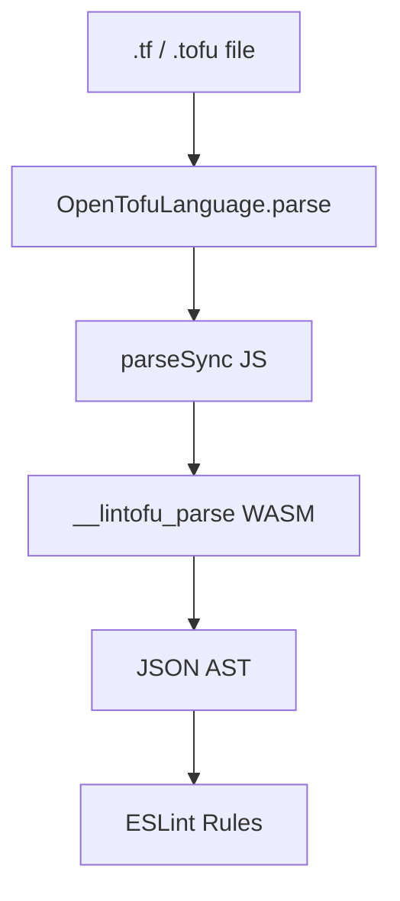

# lintofu

An ESLint plugin for linting [OpenTofu](https://opentofu.org) configurations.

> [!WARNING]
> The parser depends on Go's [`syscall/js`](https://pkg.go.dev/syscall/js), which the Go team has declared experimental and exempt from the Go compatibility promise. A future Go release can break us. `lintofu` will stay on `0.x` until `syscall/js` stabilizes or we replace it. See [ADR 0001](./docs/adr/0001-syscall-js-experimental.md).

Pre-1.0. API and rule set may change. Published to GitHub Packages under the `@synapsestudios` scope while it's being tested internally; a move to the public npm registry will follow.

## What it is

`lintofu` is an **ESLint language plugin** (the same mechanism that powers [`@eslint/json`](https://github.com/eslint/json) and [`@eslint/css`](https://github.com/eslint/css)). It parses `.tf` and `.tofu` files using HashiCorp's own `hcl/v2` parser (compiled to WebAssembly) and exposes the AST to ESLint rules so you can enforce OpenTofu coding conventions alongside the rest of your ESLint rules.

## Scope

`lintofu` checks syntactic and stylistic conventions: documentation, pinning, and the structural patterns listed under [Rules](#rules). Its boundaries:

- Semantic validation belongs to `tofu validate`. `lintofu` leaves that to OpenTofu.
- Semantic and evaluated rules (type-checking, symbol resolution) belong to the future built-in linter described in the [OpenTofu linting RFC](https://github.com/opentofu/opentofu/pull/3999), which needs the full language runtime. `lintofu` stays on the syntactic and stylistic side, where ESLint's ecosystem already fits.
- `lintofu` is a fresh ESLint-native tool. It shares no code with TFLint, which lacks OpenTofu-specific feature support.

## Install

```sh
npm install --save-dev @synapsestudios/lintofu
```

The package lives in GitHub Packages, so consumers need an `.npmrc` that maps the `@synapsestudios` scope to the registry and supplies a token with `read:packages`:

```
@synapsestudios:registry=https://npm.pkg.github.com
//npm.pkg.github.com/:_authToken=${GITHUB_TOKEN}
```

Requires Node ^20.19, ^22.13, or >=24 and ESLint ^9 || ^10.

## Usage

```js
// eslint.config.js
import lintofu from "@synapsestudios/lintofu";

export default [lintofu.configs.recommended];
```

Or wire up manually for full control:

```js
// eslint.config.js
import lintofu from "@synapsestudios/lintofu";

export default [
  {
    files: ["**/*.tf", "**/*.tofu"],
    plugins: { lintofu },
    language: "lintofu/opentofu",
    rules: {
      "lintofu/documented-variables": "error",
      "lintofu/required-providers-pinned": "error",
    },
  },
];
```

## Rules

| Rule                                                                     | Description                                                                          |
| ------------------------------------------------------------------------ | ------------------------------------------------------------------------------------ |
| [`documented-variables`](./docs/rules/documented-variables.md)           | Every `variable` block must have a non-empty `description`.                          |
| [`no-reserved-variable-names`](./docs/rules/no-reserved-variable-names.md) | A `variable` block must not be named after an OpenTofu reserved meta-argument.       |
| [`documented-outputs`](./docs/rules/documented-outputs.md)               | Every `output` block must have a non-empty `description`.                            |
| [`required-providers-pinned`](./docs/rules/required-providers-pinned.md) | Every provider in `terraform.required_providers` must declare a `version`.           |
| [`provider-source-required`](./docs/rules/provider-source-required.md)   | Every provider in `terraform.required_providers` must declare an explicit `source`.  |
| [`module-source-pinned`](./docs/rules/module-source-pinned.md)           | `module` sources must be pinned via `?ref=`, a `version` attribute, or a local path. |
| [`prefer-bare-expression`](./docs/rules/prefer-bare-expression.md)       | Flag the redundant `"${expr}"` wrapping pattern.                                     |
| [`no-legacy-list-function`](./docs/rules/no-legacy-list-function.md)     | Flag the legacy `list(...)` function, removed in Terraform 0.15; use `[...]`. Autofixable. |
| [`no-legacy-map-function`](./docs/rules/no-legacy-map-function.md)       | Flag the legacy `map(...)` function, removed in Terraform 0.15; use a `{ key = value }` object literal. Autofixable. |
| [`no-legacy-provider-proxy`](./docs/rules/no-legacy-provider-proxy.md)   | Flag empty proxy `provider` blocks; declare aliases via `configuration_aliases`.     |
| [`no-template-provider`](./docs/rules/no-template-provider.md)           | Flag use of the archived `hashicorp/template` provider.                              |
| [`no-terraform-env-reference`](./docs/rules/no-terraform-env-reference.md) | Flag references to `terraform.env`; use `terraform.workspace` instead. Autofixable. |
| [`no-quoted-type-constraints`](./docs/rules/no-quoted-type-constraints.md) | Flag quoted type constraints in `variable` blocks; use the unquoted type keyword. Autofixable. |
| [`no-splat-bracket-index`](./docs/rules/no-splat-bracket-index.md)       | Warn on a constant index applied to a splat result (`x.*.id[0]`); index the collection first. |
| [`remote-state-outputs-prefix`](./docs/rules/remote-state-outputs-prefix.md) | Flag `data.terraform_remote_state.<name>.<attr>` references that omit the `.outputs.` prefix. Autofixable. |
| [`no-bool-as-count`](./docs/rules/no-bool-as-count.md)                   | Flag a `count` set to a provable boolean; Terraform 0.12 removed bool-to-number coercion. Autofixable. |
| [`no-external-refs-in-destroy-provisioner`](./docs/rules/no-external-refs-in-destroy-provisioner.md) | Flag references to anything other than `self`, `count.index`, or `each.key`/`each.value` inside `provisioner` blocks with `when = destroy`. |
| [`no-legacy-ignore-changes-wildcard`](./docs/rules/no-legacy-ignore-changes-wildcard.md) | Flag the quoted `["*"]` wildcard in a `lifecycle` `ignore_changes` list; use the unquoted `all` keyword instead. Autofixable. |
| [`no-legacy-count-attribute`](./docs/rules/no-legacy-count-attribute.md) | Flag references to a resource's legacy `.count` attribute, removed in Terraform 0.12; use `length(...)`. Autofixable. |
| [`no-legacy-security-group-rules`](./docs/rules/no-legacy-security-group-rules.md) | Flag legacy `aws_security_group_rule` and inline `ingress`/`egress` blocks.    |
| [`no-mixed-security-group-rule-forms`](./docs/rules/no-mixed-security-group-rule-forms.md) | Warn when a standalone SG rule targets an `aws_security_group` with inline blocks (drift). |
| [`no-pinned-minor-with-auto-upgrade`](./docs/rules/no-pinned-minor-with-auto-upgrade.md) | Warn when `engine_version` is pinned deeper than an enabled `auto_minor_version_upgrade` holds stable (drift), per engine. |
| [`no-aurora-pinned-minor-with-auto-upgrade`](./docs/rules/no-aurora-pinned-minor-with-auto-upgrade.md) | Warn when an Aurora PostgreSQL cluster pins `engine_version` deeper than auto minor upgrade across its instances holds stable (drift). |
| [`no-iam-policy-attachment`](./docs/rules/no-iam-policy-attachment.md) | Warn on `aws_iam_policy_attachment`, which manages a policy's attachments exclusively account-wide; use the per-principal `*_policy_attachment` or `*_policy_attachments_exclusive` resources. |
| [`no-s3-bucket-inline-config`](./docs/rules/no-s3-bucket-inline-config.md) | Warn on deprecated inline config on `aws_s3_bucket` (acl, policy, versioning, logging, ...); use the standalone `aws_s3_bucket_*` resources. |
| [`no-legacy-dot-index`](./docs/rules/no-legacy-dot-index.md) | Flag legacy dot index (`list.0`) and attribute splat (`a.*.b`); use `list[0]` and `a[*].b`. Autofixable. |
| [`no-legacy-lookup`](./docs/rules/no-legacy-lookup.md) | Flag two-argument `lookup()`, deprecated since Terraform 0.7; use index syntax `var.tags["Name"]`. Autofixable. |
| [`no-quoted-depends-on`](./docs/rules/no-quoted-depends-on.md) | Flag quoted references in `depends_on`; use bare references. Autofixable. |
| [`no-quoted-provider-reference`](./docs/rules/no-quoted-provider-reference.md) | Flag quoted `provider` arguments and quoted keys/values in module `providers` maps; use bare traversals. Autofixable. |
| [`no-quoted-ignore-changes`](./docs/rules/no-quoted-ignore-changes.md) | Flag quoted references in `lifecycle` `ignore_changes`; use bare attribute references. Autofixable. |
| [`no-empty-list-equality`](./docs/rules/no-empty-list-equality.md) | Flag `==`/`!=` against an empty tuple `[]`, which never matches a list, set, or map; use `length(expr) == 0`. Autofixable. |
| [`no-winrm-connection`](./docs/rules/no-winrm-connection.md) | Warn on `connection` blocks with `type = "winrm"`, deprecated in OpenTofu 1.12 and slated for removal in 1.13; use `type = "ssh"`. |
| [`typed-variables`](./docs/rules/typed-variables.md) | Every `variable` block must declare a `type`; an explicit `type = any` is an accepted opt-out. |
| [`no-iam-role-inline-policies`](./docs/rules/no-iam-role-inline-policies.md) | Warn on deprecated `inline_policy` blocks (including `dynamic`) and `managed_policy_arns` on `aws_iam_role`; prefer standalone policy/attachment resources. |
| [`no-eip-vpc-attribute`](./docs/rules/no-eip-vpc-attribute.md) | Flag the `vpc` argument on `aws_eip`, removed in AWS provider v6; use `domain = "vpc"`. Autofixable. |
| [`no-instance-cpu-count-attributes`](./docs/rules/no-instance-cpu-count-attributes.md) | Flag `cpu_core_count`/`cpu_threads_per_core` on `aws_instance`, removed in AWS provider v6; use a `cpu_options` block. Autofixable. |
| [`required-version-declared`](./docs/rules/required-version-declared.md) | Warn when a `terraform` block declares `required_providers` but no `terraform` block in the file sets `required_version`. |
| [`no-duplicate-map-keys`](./docs/rules/no-duplicate-map-keys.md) | Flag a repeated statically-known key in an object literal; HCL keeps only the last entry and silently discards the earlier ones. |
| [`no-provider-version-constraint`](./docs/rules/no-provider-version-constraint.md) | Flag a `version` argument inside a `provider` block; declare the constraint in `terraform.required_providers` instead. |
| [`no-db-instance-name-attribute`](./docs/rules/no-db-instance-name-attribute.md) | Flag the top-level `name` argument on `aws_db_instance`, removed in AWS provider v5; use `db_name`. Autofixable. |
| [`no-eks-addon-resolve-conflicts`](./docs/rules/no-eks-addon-resolve-conflicts.md) | Flag `resolve_conflicts` on `aws_eks_addon`, removed in AWS provider v6; use `resolve_conflicts_on_create` and `resolve_conflicts_on_update`. |
| [`no-api-gateway-deployment-stage-args`](./docs/rules/no-api-gateway-deployment-stage-args.md) | Flag `stage_name`, `stage_description`, and `canary_settings` on `aws_api_gateway_deployment`, removed in AWS provider v6; manage the stage with a separate `aws_api_gateway_stage`. |
| [`no-s3-bucket-object`](./docs/rules/no-s3-bucket-object.md) | Flag the deprecated `aws_s3_bucket_object` resource and the `aws_s3_bucket_object`/`aws_s3_bucket_objects` data sources; use `aws_s3_object`/`aws_s3_objects`. |
| [`no-hardcoded-provider-credentials`](./docs/rules/no-hardcoded-provider-credentials.md) | Flag literal `access_key`, `secret_key`, or `token` values in `provider "aws"` and s3 `backend` blocks. |
| [`no-deprecated-lambda-runtime`](./docs/rules/no-deprecated-lambda-runtime.md) | Flag AWS-deprecated Lambda `runtime` values on `aws_lambda_function` and `compatible_runtimes` elements on `aws_lambda_layer_version`. |

## Requesting a rule

To suggest a new rule, open a [rule request](https://github.com/synapsestudios/lintofu/issues/new?template=rule-request.yml). The form asks for a snippet the rule should flag, the compliant form, a category, a suggested severity, whether an autofix seems possible, and any references. A maintainer turns the request into a rule issue from there.

## Parser services

Rules have access to a lazily-built, cross-file index via `context.sourceCode.parserServices.projectIndex`:

```ts
interface ProjectIndex {
  findResource(addr: { kind: string; labels: string[] }): Block | undefined;
  resolveTraversal(expr: ScopeTraversalExpr): Block | undefined;
  resourcesByType(type: string): readonly Block[];
}
```

Scope is every `.tf` / `.tofu` file in the same directory as the file being linted, which matches OpenTofu's module boundary. The index is cached per-directory and invalidated via file mtime. `findResource` takes an explicit address; `resolveTraversal` accepts a `ScopeTraversalExpr` like `aws_security_group.foo.id` and returns the defining `Block` or `undefined`; `resourcesByType` returns every resource block of a type (e.g. `aws_rds_cluster_instance`), which cross-resource rules use to enumerate a whole type.

## Writing your own rule

`lintofu` re-exports the same rule-authoring types it uses internally, so a custom rule type-checks without reaching into private modules.

```ts
import type { OpenTofuRuleDefinition } from "@synapsestudios/lintofu";

const rule: OpenTofuRuleDefinition<{ MessageIds: "missingTags" }> = {
  meta: {
    type: "suggestion",
    docs: { description: "Require resources to declare a `tags` attribute." },
    messages: { missingTags: "Resource `{{name}}` is missing a `tags` attribute." },
    schema: [],
  },
  create(context) {
    return {
      Block(node) {
        if (node.kind !== "resource") return;
        if (node.body.attributes.some((a) => a.name === "tags")) return;
        const name = node.labels[1] ?? "<unnamed>";
        context.report({ node, messageId: "missingTags", data: { name } });
      },
    };
  },
};

export default rule;
```

`OpenTofuRuleDefinition<Options>` fills in everything ESLint's `RuleDefinition` needs (`LangOptions`, `Code`, `Visitor`, `Node`, `ExtRuleDocs`); pass `MessageIds` as a string literal union and message ids cross-check against `meta.messages` and `context.report`. The visitor is a mapped type over the AST, so `Block`, `Attribute`, `ScopeTraversalExpr`, etc. autocomplete and a typo (`Bock`) is a compile error. AST node types (`Block`, `Body`, `Attribute`, `Expression`, `ScopeTraversalExpr`, …) and the parser-services shape (`TofuParserServices`, `ProjectIndex`) are re-exported from the package root.

## Architecture

The parser is Go; we wrap `github.com/hashicorp/hcl/v2/hclsyntax` and compile it to WebAssembly. JS can't faithfully parse HCL v2 today; the existing npm packages are unmaintained or drop source positions.

At a high level:



## Known limitations

- **Experimental dependency on `syscall/js`.** See [ADR 0001](./docs/adr/0001-syscall-js-experimental.md). The project inherits its experimental status from Go's WASM JS interop package. Pinning a Go version in CI is the mitigation.
- **`.tf.json` / `.tofu.json` not supported.** The JSON form of HCL is not 1:1 with native syntax; see [hashicorp/hcl#627 for the rationale](https://github.com/hashicorp/hcl/issues/627).
- **No TFLint custom-rule compatibility.** An opinionated migration example may land later; a general compatibility layer is not planned for early releases.
- **Performance is unprofiled.** Go+WASM boot costs ~100ms per ESLint process; per-file parse is sub-millisecond after boot.
