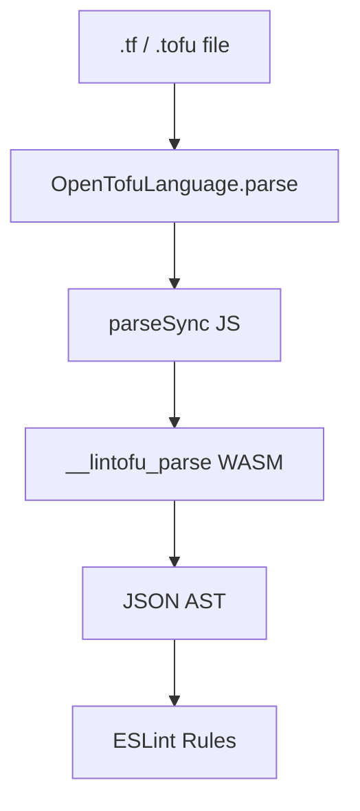

# lintofu

An ESLint plugin for linting [OpenTofu](https://opentofu.org) configurations.

> [!WARNING]
> The parser depends on Go's [`syscall/js`](https://pkg.go.dev/syscall/js), which the Go team has declared experimental and exempt from the Go compatibility promise. A future Go release can break us. `lintofu` will stay on `0.x` until `syscall/js` stabilises or we replace it. See [ADR 0001](./docs/adr/0001-syscall-js-experimental.md).

Pre-1.0. API and rule set may change. Not yet published.

## What it is

`lintofu` is an **ESLint language plugin** (the same mechanism that powers [`@eslint/json`](https://github.com/eslint/json) and [`@eslint/css`](https://github.com/eslint/css)). It parses `.tf` and `.tofu` files using HashiCorp's own `hcl/v2` parser (compiled to WebAssembly) and exposes the AST to ESLint rules so you can enforce OpenTofu coding conventions alongside the rest of your ESLint rules.

## What it is not

- **Not a replacement for `tofu validate`.** Validation is OpenTofu's job.
- **Not competition for a future built-in OpenTofu linter.** The [OpenTofu linting RFC](https://github.com/opentofu/opentofu/pull/3999) covers semantic/evaluated rules (type-checking, symbol resolution) that need the full language runtime. `lintofu` stays on the syntactic/stylistic side (conventions, documentation, pinning) where ESLint's ecosystem is already a good fit.
- **Not a TFLint fork.** TFLint doesn't support OpenTofu-specific features. This is a fresh ESLint-native tool.

## Install

```sh
npm install --save-dev lintofu
```

Requires Node ^20.19, ^22.13, or >=24 and ESLint ^9 || ^10.

## Usage

```js
// eslint.config.js
import lintofu from "lintofu";

export default [lintofu.configs.recommended];
```

Or wire up manually for full control:

```js
// eslint.config.js
import lintofu from "lintofu";

export default [
  {
    files: ["**/*.tf", "**/*.tofu"],
    plugins: { lintofu },
    language: "lintofu/opentofu",
    rules: {
      "lintofu/documented-variables": "error",
      "lintofu/required-providers-pinned": "error",
    },
  },
];
```

## Rules

| Rule                                                                     | Description                                                                          |
| ------------------------------------------------------------------------ | ------------------------------------------------------------------------------------ |
| [`documented-variables`](./docs/rules/documented-variables.md)           | Every `variable` block must have a non-empty `description`.                          |
| [`documented-outputs`](./docs/rules/documented-outputs.md)               | Every `output` block must have a non-empty `description`.                            |
| [`required-providers-pinned`](./docs/rules/required-providers-pinned.md) | Every provider in `terraform.required_providers` must declare a `version`.           |
| [`module-source-pinned`](./docs/rules/module-source-pinned.md)           | `module` sources must be pinned via `?ref=`, a `version` attribute, or a local path. |
| [`prefer-bare-expression`](./docs/rules/prefer-bare-expression.md)       | Flag the redundant `"${expr}"` wrapping pattern.                                     |
| [`no-legacy-provider-proxy`](./docs/rules/no-legacy-provider-proxy.md)   | Flag empty proxy `provider` blocks; declare aliases via `configuration_aliases`.     |
| [`no-template-provider`](./docs/rules/no-template-provider.md)           | Flag use of the archived `hashicorp/template` provider.                              |
| [`no-external-refs-in-destroy-provisioner`](./docs/rules/no-external-refs-in-destroy-provisioner.md) | Flag references to anything other than `self`, `count.index`, or `each.key`/`each.value` inside `provisioner` blocks with `when = destroy`. |
| [`no-legacy-security-group-rules`](./docs/rules/no-legacy-security-group-rules.md) | Flag legacy `aws_security_group_rule` and inline `ingress`/`egress` blocks.    |
| [`no-mixed-security-group-rule-forms`](./docs/rules/no-mixed-security-group-rule-forms.md) | Warn when a standalone SG rule targets an `aws_security_group` with inline blocks (drift). |

## Parser services

Rules have access to a lazily-built, cross-file index via `context.sourceCode.parserServices.projectIndex`:

```ts
interface ProjectIndex {
  findResource(addr: { kind: string; labels: string[] }): Block | undefined;
  resolveTraversal(expr: ScopeTraversalExpr): Block | undefined;
}
```

Scope is every `.tf` / `.tofu` file in the same directory as the file being linted — matching OpenTofu's module boundary. The index is cached per-directory and invalidated via file mtime. `findResource` takes an explicit address; `resolveTraversal` accepts a `ScopeTraversalExpr` like `aws_security_group.foo.id` and returns the defining `Block` or `undefined`.

## Writing your own rule

`lintofu` re-exports the same rule-authoring types it uses internally, so a custom rule type-checks without reaching into private modules.

```ts
import type { OpenTofuRuleDefinition } from "lintofu";

const rule: OpenTofuRuleDefinition<{ MessageIds: "missingTags" }> = {
  meta: {
    type: "suggestion",
    docs: { description: "Require resources to declare a `tags` attribute." },
    messages: { missingTags: "Resource `{{name}}` is missing a `tags` attribute." },
    schema: [],
  },
  create(context) {
    return {
      Block(node) {
        if (node.kind !== "resource") return;
        if (node.body.attributes.some((a) => a.name === "tags")) return;
        const name = node.labels[1] ?? "<unnamed>";
        context.report({ node, messageId: "missingTags", data: { name } });
      },
    };
  },
};

export default rule;
```

`OpenTofuRuleDefinition<Options>` fills in everything ESLint's `RuleDefinition` needs (`LangOptions`, `Code`, `Visitor`, `Node`, `ExtRuleDocs`); pass `MessageIds` as a string literal union and message ids cross-check against `meta.messages` and `context.report`. The visitor is a mapped type over the AST, so `Block`, `Attribute`, `ScopeTraversalExpr`, etc. autocomplete and a typo (`Bock`) is a compile error. AST node types (`Block`, `Body`, `Attribute`, `Expression`, `ScopeTraversalExpr`, …) and the parser-services shape (`TofuParserServices`, `ProjectIndex`) are re-exported from the package root.

## Architecture

The parser is Go; we wrap `github.com/hashicorp/hcl/v2/hclsyntax` and compile it to WebAssembly. JS can't faithfully parse HCL v2 today; the existing npm packages are unmaintained or drop source positions.

At a high level:



## Known limitations

- **Experimental dependency on `syscall/js`.** See [ADR 0001](./docs/adr/0001-syscall-js-experimental.md). The project inherits its experimental status from Go's WASM JS interop package. Pinning a Go version in CI is the mitigation.
- **AST coverage is partial.** Function calls, conditionals, for-expressions, splats, and a few other expression types currently fall back to `UnknownExpr`, so rules that need to inspect their internals can't. They will be added as rules need them.
- **`.tf.json` / `.tofu.json` not supported.** The JSON form of HCL is not 1:1 with native syntax; see [hashicorp/hcl#627 for the rationale](https://github.com/hashicorp/hcl/issues/627).
- **No TFLint custom-rule compatibility.** An opinionated migration example may land later; a general compatibility layer is not planned for early releases.
- **Performance is unprofiled.** Go+WASM boot costs ~100ms per ESLint process; per-file parse is sub-millisecond after boot.

### AST coverage

Anything marked Not Yet Implemented falls back to `UnknownExpr`, so rules can see the node and its source range but can't inspect its internals.

| Expression Type[^ast-coverage]                               | Supported | Not Yet Implemented |
| ------------------------------------------------------------ | --------- | ------------------- |
| `LiteralValueExpr` (strings, numbers, bools)                 | ✅        |                     |
| `TemplateExpr` (quoted / interpolated strings)               | ✅        |                     |
| `TemplateWrapExpr`                                           | ✅        |                     |
| `ScopeTraversalExpr` (e.g. `var.foo`, `aws_instance.web.id`) | ✅        |                     |
| `ObjectConsExpr` / `ObjectConsKeyExpr` (object literals)     | ✅        |                     |
| `TupleConsExpr` (list literals)                              |           | ❌                  |
| `FunctionCallExpr`                                           |           | ❌                  |
| `ConditionalExpr`                                            |           | ❌                  |
| `ForExpr`                                                    |           | ❌                  |
| `SplatExpr`                                                  |           | ❌                  |
| `IndexExpr`                                                  |           | ❌                  |
| `RelativeTraversalExpr`                                      |           | ❌                  |
| `BinaryOpExpr` / `UnaryOpExpr`                               |           | ❌                  |
| `ParenthesesExpr`                                            |           | ❌                  |

[^ast-coverage]: This list is non-exhaustive and will likely be expanded as new expression types are added to the parser.
